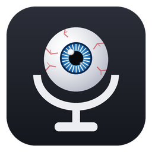
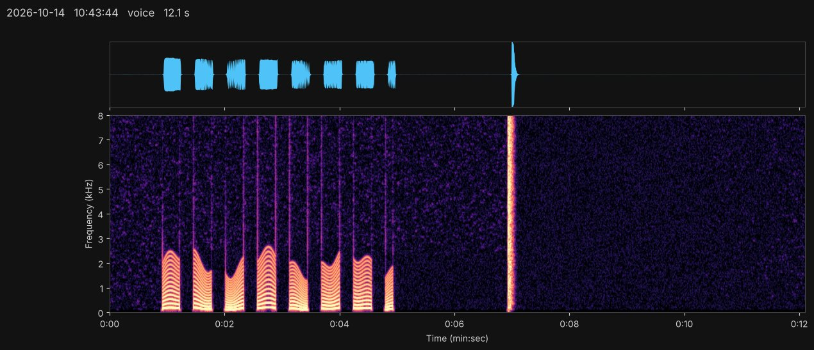

#  Room Recorder

Turn any PC microphone into a room audio recorder. Record 24/7 or only when something happens, with noise reduction that strips out hard drive hum, fans and HVAC so you can run the mic gain high. Every clip gets a waveform + spectrogram image so you can scan a day's activity at a glance.

[](example.jpg)

*A voice-activated clip: talking shows as stacked bands below ~3 kHz, a door slam as a sharp vertical line.*

## Features

- **Voice-activated or 24/7** recording, with timestamped files in one folder per day
- **Noise reduction** that learns the room's steady background (hard drive, fans, PC whine, HVAC) per frequency and keeps adapting as it changes
- **Smart triggering** - recording starts when sound rises above the learned background in the voice range, not at a fixed volume, so a noisy room doesn't cause false alarms
- **Pre-roll** - each clip includes the second *before* the trigger
- **Spectrogram image** (`.jpg`) saved next to every clip
- **Storage cap** - oldest recordings are deleted automatically when the folder hits your limit
- **Volume boost** with a soft limiter, and a 100 Hz rumble filter
- **Windows menu** (`run.bat`) - no command line needed, settings are remembered, optional start-with-Windows
- **Taskbar shortcut** with its own icon, created from the menu in one step
- Keeps the PC awake while recording (the screen can still turn off)

## Quick start (Windows)

1. Install Python from [python.org/downloads](https://www.python.org/downloads/). On the first installer screen, check **"Add python.exe to PATH"**.
2. Download this repo (**Code → Download ZIP**) and extract it, e.g. to `C:\RoomRecorder`.
3. Make sure **Settings → Privacy & security → Microphone → Let desktop apps access your microphone** is on.
4. Double-click **`run.bat`**. The first run installs the required libraries automatically.
5. Pick **[1] Start recording**. Stay quiet for the first 3 seconds while it learns the room.
6. *(Optional)* Pick **[8] Create desktop shortcut**, then right-click the new **Room Recorder** shortcut on your desktop → **Pin to taskbar** (on Windows 11 it may be under **Show more options**). You can delete the desktop shortcut after pinning.

Recordings are saved to `recordings\YYYY-MM-DD\HH-MM-SS_voice.flac` (plus a matching `.jpg`).
Press **Ctrl+C** to stop; if Windows asks *"Terminate batch job (Y/N)?"*, press **N** to return to the menu.

### Menu

| Main menu | |
|---|---|
| 1 | Start recording |
| 2 | Switch mode (voice-activated / 24-7) |
| 3 | Settings |
| 4 | Live level meter |
| 5 | Open recordings folder |
| 6 | Make spectrogram images for older recordings |
| 7 | Install / repair required libraries |
| 8 | Create desktop shortcut (to pin to taskbar) |

| Settings | |
|---|---|
| 1 | Microphone |
| 2 | Sensitivity - High / Normal / Low, or a fixed level |
| 3 | Quiet time before a clip ends |
| 4 | Storage cap (GB) |
| 5 | File length in 24/7 mode |
| 6 | File format (FLAC / WAV) |
| 7 | Recordings folder |
| 8 | Start when Windows starts |
| 9 | Spectrogram image per clip |
| N | Noise reduction - Off / Low / Medium / High |
| B | Volume boost (dB) |

Settings are stored in `settings.ini` next to `run.bat`.

### Pinning to the taskbar

Windows won't pin a `.bat` file directly, so menu option **[8]** makes a shortcut that runs `run.bat` through Command Prompt, using `RoomRecorder.ico` as its icon. Right-click it → **Pin to taskbar**.

<details>
<summary>Making the shortcut by hand</summary>

1. Right-click the desktop → **New → Shortcut**.
2. Enter `cmd.exe /c "C:\RoomRecorder\run.bat"` (use your folder's path) and name it **Room Recorder**.
3. Right-click the shortcut → **Properties**. Set **Start in** to your folder, click **Change Icon… → Browse**, and pick `RoomRecorder.ico`.
4. Right-click the shortcut → **Pin to taskbar**.

If you change the icon on a shortcut that's already pinned, unpin and re-pin it - Windows caches pinned icons.
</details>

### Moving the folder

The whole folder is portable - cut and paste it anywhere, including another drive. Settings travel with it, and so do recordings if the recordings folder is left at its default.

- **Start with Windows** updates itself to the new location the next time you open `run.bat`.
- **A pinned taskbar shortcut** still points to the old location. Unpin it, run menu option **[8]** again, and re-pin.
- If you set a full path for the recordings folder (e.g. `D:\Recordings`), new recordings keep going there.

## Command line (Windows, macOS, Linux)

```
pip install -r requirements.txt
python room_recorder.py                          # voice-activated
python room_recorder.py --mode continuous        # 24/7 in 30-minute files
python room_recorder.py --meter                  # live levels, for tuning
python room_recorder.py --list-devices           # find your mic's number
python room_recorder.py --denoise high --boost 12 --device 2
```

Linux also needs `sudo apt install libportaudio2 libsndfile1`. On macOS, allow Terminal to use the microphone when prompted, and run with `caffeinate -i python3 room_recorder.py` to keep the Mac awake.

| Option | Default | What it does |
|---|---|---|
| `--mode` | `voice` | `voice` or `continuous` |
| `--device` | system default | Microphone number from `--list-devices` |
| `--out` | `recordings` | Output folder |
| `--format` | `flac` | `flac` (lossless, ~half the size) or `wav` |
| `--max-gb` | `20` | Delete oldest recordings above this size |
| `--denoise` | `medium` | `off`, `low`, `medium`, `high` |
| `--highpass` | `100` | Cut rumble below this many Hz (`0` = off) |
| `--boost` | `0` | Extra dB of volume on saved audio, soft-limited |
| `--margin` | `8` | Trigger when the voice range is this many dB above the background (High 5, Normal 8, Low 12) |
| `--threshold` | - | Trigger at a fixed level in dBFS instead (shown by `--meter`) |
| `--hang` | `5` | Seconds of quiet before a clip ends |
| `--preroll` | `1.0` | Seconds kept from before the trigger |
| `--min-loud` | `0.3` | Discard clips with less sound than this (clicks, bumps) |
| `--max-clip-minutes` | `10` | Split very long clips (e.g. a TV left on) |
| `--chunk-minutes` | `30` | File length in continuous mode |
| `--calibrate-sec` | `3` | Seconds spent learning the background at startup |
| `--no-spectrograms` | - | Don't save a `.jpg` with each clip |
| `--make-spectrograms` | - | Draw images for existing recordings, then exit |
| `--allow-sleep` | - | Windows: let the PC sleep while running |

## How the noise reduction works

Audio is processed in 40 ms frames. For every frequency, the recorder keeps a running estimate of the background level. Frequencies that look like background update quickly (about 1 second); frequencies far above it are treated as a real sound and only creep into the estimate (about 50 seconds), so a conversation isn't "learned" as noise but a newly switched-on fan is. The background is then subtracted from each frame (spectral subtraction with smoothing to avoid watery artifacts).

The same estimate drives the trigger: a recording starts when the 250-4000 Hz range rises a set number of dB above it.

In testing with simulated hard drive and fan noise:

| Noise reduction | Background removed |
|---|---|
| Low | ~13 dB |
| Medium | ~20 dB |
| High | ~28 dB |

Noise reduction removes *steady* sounds. Short transients like drive seek clicks can still come through; `--min-loud` discards most clips made only of those.

**Tip:** keep the mic off the desk the PC sits on - drive vibration travels through the desk. A folded towel or foam under the mic helps a lot.

## Storage

At the default 16 kHz mono:

| Mode | Per hour | 20 GB lasts |
|---|---|---|
| 24/7, noise reduction on (FLAC) | ~60 MB | ~15 days |
| 24/7, noise reduction off (FLAC) | ~80 MB | ~11 days |
| 24/7, WAV | ~115 MB | ~8 days |
| Voice-activated | depends on activity | months |

When the cap is reached the oldest files are deleted, so you always keep the most recent recordings.

## Troubleshooting

- **Recordings are silent** - Windows microphone privacy setting is off, or the wrong device is selected (Settings → 1).
- **Too many false triggers** - lower sensitivity, raise noise reduction, or move the mic away from the PC.
- **Missing quiet sounds** - raise sensitivity to High, or increase the mic gain in Windows sound settings.
- **Taskbar icon didn't change** - unpin the shortcut and pin it again.
- **`python` opens the Microsoft Store** - reinstall Python with "Add python.exe to PATH" checked. `run.bat` also tries the `py` launcher.

## A note on recording laws

Recording laws vary by place. Recording your own space to detect intrusions is generally fine, but capturing conversations between other people when you aren't part of them can violate wiretap laws in many places, even in your own home. If others share the space, tell them the recorder exists. This isn't legal advice - check the rules where you live.

## License

[MIT](LICENSE)
